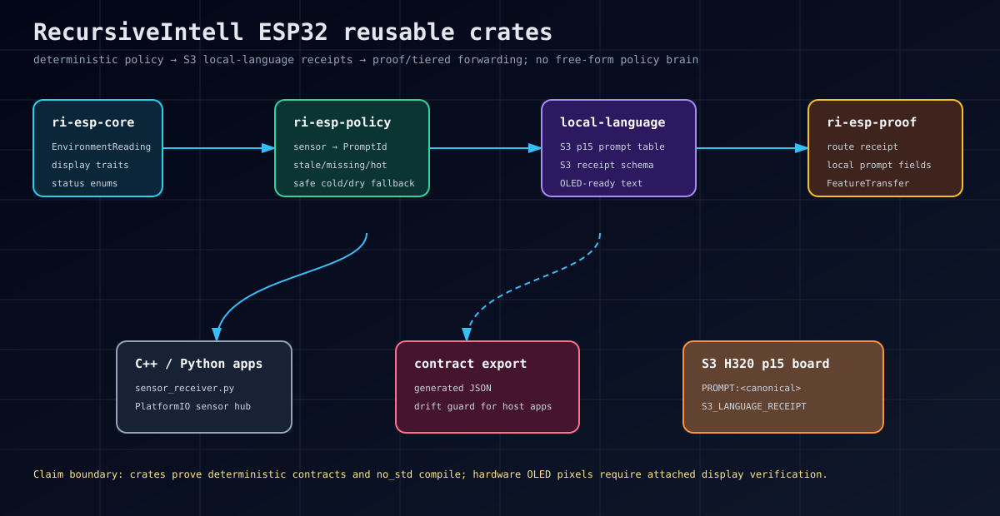

# ESP32 Reusable Crates

<!-- last-verified: 2026-10-26 -->

Reusable, no_std-first Rust crates distilled from RecursiveIntell ESP32/ESP32-S3 physical-AI experiments.



## What this gives you

This workspace turns one-off firmware work into small reusable crates:

- deterministic sensor policy instead of prompt-only behavior
- local-language receipt contracts for the ESP32-S3 H320 p15 status model
- proof receipts that say why a board stayed local or escalated
- fixed-capacity payloads for tiered ESP32 -> gateway/GPU forwarding
- embedded inference helpers that stay separate from product policy
- board/display utilities that avoid re-learning ESP32 pin and screen traps

## Crates

| crate | role |
|---|---|
| `ri-esp-core` | shared no_std readings, status enums, display/sensor traits |
| `ri-esp-board-profiles` | ESP32/S3 board constants and known-bad pin guardrails |
| `ri-esp-display` | HD44780+PCF8574 and ILI9341 display primitives |
| `ri-esp-llm` | int4, KV cache, RNN, sampling, compressed attention primitives |
| `ri-esp-tiered` | no_std fixed-capacity feature-transfer payloads |
| `ri-esp-policy` | deterministic sensor-state -> canonical PromptId policy |
| `ri-esp-local-language` | S3 p15 prompt/output and receipt contracts |
| `ri-esp-proof` | route/provenance receipts and policy-aware proof flow |

## Current sensor-policy flow

```text
EnvironmentReading
  -> ri-esp-policy: deterministic thresholds and PromptId
  -> ri-esp-local-language: canonical prompt/output + S3 receipt schema
  -> ri-esp-proof: provenance receipt with local_language_model/prompt
  -> host/firmware: OLED-ready text and optional AI escalation
```

The shared JSON contract for C++/Python consumers lives at:

`contracts/sensor_policy_s3_local_language_v1.json`

The sensor hub receiver now loads that contract instead of keeping a disconnected prompt table.

## Quick start

Add the three crates used in this example to your application's `Cargo.toml`:

```toml
[dependencies]
ri-esp-core = "0.1.1"
ri-esp-policy = "0.1.1"
ri-esp-proof = "0.1.1"
```

This complete host-side example evaluates one sensor reading and prints the
receipt's routing decision and canonical prompt. Replace `"gateway"` with the
route label used by your application; the library does not connect to that
route or invoke an AI service.

```rust
use ri_esp_core::EnvironmentReading;
use ri_esp_policy::PolicyContext;
use ri_esp_proof::{ProofConfig, ProofEngine};

fn main() {
    let sensor = EnvironmentReading::new(31.0, 70.0, None);
    let ctx = PolicyContext::new(sensor, 3_000).with_last_read_ms(2_900);
    let mut engine = ProofEngine::new(ProofConfig::default());
    let receipt = engine.evaluate_with_policy("esp32-node", ctx, "gateway");

    assert_eq!(
        receipt.local_language_prompt.as_str(),
        "high heat and humidity. action is "
    );
    println!(
        "{}: {}",
        receipt.decision.as_str(),
        receipt.local_language_prompt.as_str()
    );
}
```

Run it with `cargo run` in the application's crate. For an already parsed
`serde_json::Value`, use `Canonicalizer` or `canonicalize_flexible` directly.
Use `ContentDigest::compute` when you need a digest for canonicalized content.

## Verification

The Rust workspace at base commit `757c4105f96a53bb73e29ee7bab24fdfca0238d1` was checked on 2026-10-25. The README-only candidate leaves that source unchanged; the same host-side checks were rerun locally on 2026-10-26 for this documentation update:

```bash
cargo fmt --all -- --check
cargo test --workspace
cargo clippy --workspace --all-targets -- -D warnings
```

The 2026-10-26 rerun of these three host-side checks passed; `cargo test --workspace` ran 35 tests with no failures. This is not ESP32 hardware or Xtensa-target validation. The test used the stable toolchain's Cargo binary directly because this environment's Cargo dispatcher routes Cargo tests through an offline worker.

Historical integration checks recorded for July 1, 2026; these commands and results were not run for this README update. The Python command assumes a sibling `esp32-sensor-hub` checkout:

```bash
cargo +esp check --target xtensa-esp32s3-none-elf -Z build-std=core,alloc --workspace --lib
python3 ../esp32-sensor-hub/tools/test_sensor_policy_s3_language.py --rounds 1 --timeout-s 5
```

The historical records reported:

- ESP32-S3 no_std library check passed.
- The Python sensor-hub hard test without hardware S3 passed 9 policy cases, 9 static bridge cases, and 9 HTTP cases.
- A previous machine-local hardware receipt reported 24 real ESP32-S3 H320 p15 generations across 8 prompts. The receipt is not included in this repository; reproduce it with the sensor-hub harness before relying on it for another board.

## Claim boundary

This workspace proves deterministic contracts and no_std compile/test behavior. It does not certify OLED physical pixels, safety-critical actuation, production maturity, or model quality outside the canonical prompt set.

## Single-board Sentinel design

- [Independent single-board ESP32-S3 Sentinel architecture (2026-07-15)](docs/SINGLE_BOARD_SENTINEL_ARCHITECTURE_2026-07-15.md)
- [Machine-readable ESP32-S3 research and artifact inventory](docs/ESP32S3_RESEARCH_INVENTORY_2026-07-15.json)

## License

MIT OR Apache-2.0
